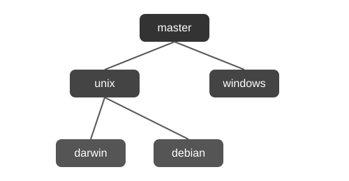

# Dotfiles

This is a modular and scalable setup designed for managing dotfiles configurations across multiple platforms. Each platform is represented by a dedicated Git branch.

Below is a visual representation of how the branches are organized:



## 📚 Table of Contents

- [🚀 Quick Start](#-quick-start)
  - [1. Install the Prerequisites](#1-install-the-prerequisites)
    - [Darwin](#darwin)
    - [Debian](#debian)
    - [Windows](#windows)
  - [2. Clone the Repository](#2-clone-the-repository)
  - [3. Run the Bootstrap Script](#3-run-the-bootstrap-script)
    - [Darwin & Debian](#darwin--debian)
    - [Windows](#windows-1)
- [🌟 Contributing](#-contributing)
- [📜 License](#-license)


## 🚀 Quick Start

### 1. Install the Prerequisites

#### Darwin:
```bash
xcode-select --install
```

#### Debian:
```bash
sudo apt install git zsh
```

#### Windows:
```powershell
winget install --id Git.Git -e
```

### 2. Clone the Repository

```bash
git clone --branch <platform-branch-name> https://github.com/mariusmucenicu/dotfiles.git dotfiles
cd dotfiles
```

Replace `<platform-branch-name>` with your platform of choice:
- `darwin`
- `windows`
- `debian`

### 3. Run the Bootstrap Script

Each branch includes a platform-specific entry point in the `scripts` directory. For example:

#### Darwin & Debian:
```bash
./scripts/bootstrap
```

#### Windows:
```powershell
.\scripts\bootstrap.ps1
```

## 🌟 Contributing

This repository is primarily for personal use, but feel free to explore it and adapt it for your workflow. If you spot any issues or have suggestions, feel free to open a pull request or issue.


## 📜 License

This project is licensed under the **GPL-3.0-or-later** license. See the [COPYING](../COPYING) file for details.

---

Happy hacking!
